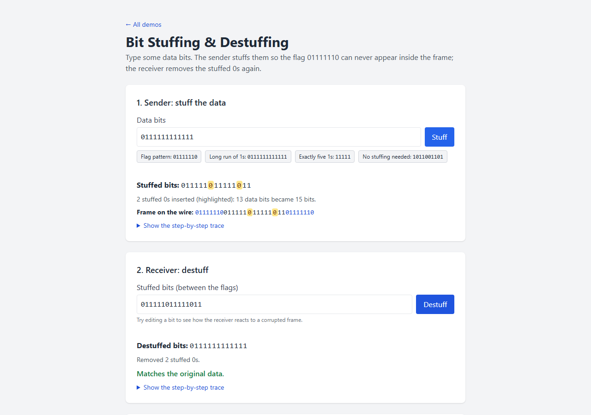
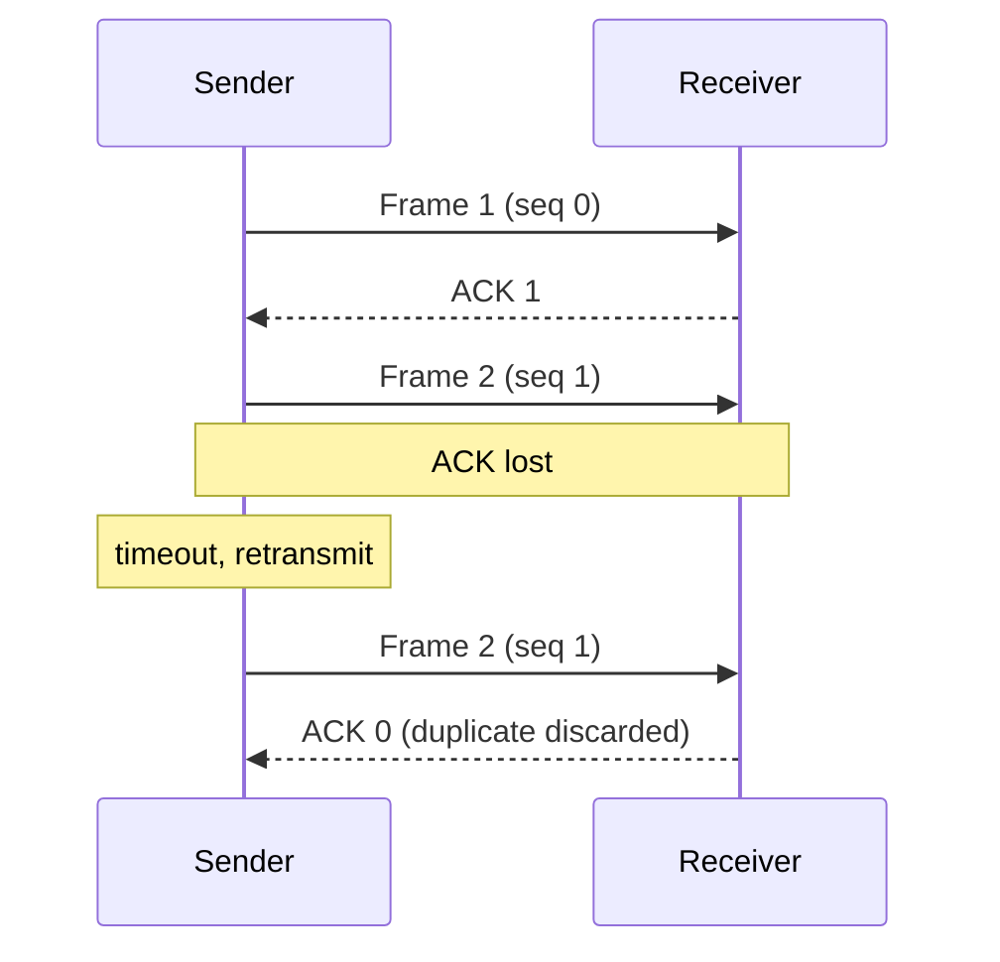
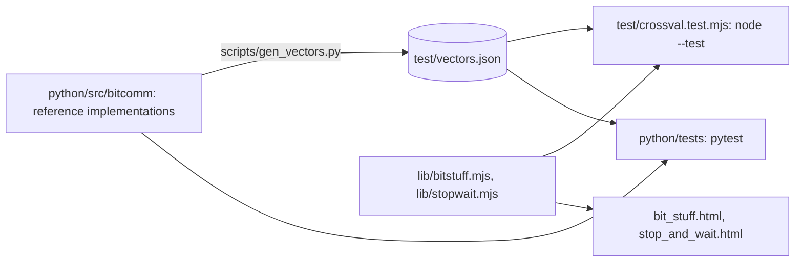

# Data Communication Demos: interactive bit stuffing and stop-and-wait ARQ

[](https://creativecommons.org/licenses/by-nc-nd/4.0/)
[](https://janeferdinant.github.io/bit/)

## Overview

Two small browser demos for teaching the data link layer: **bit stuffing and destuffing** (HDLC-style framing) and the **stop-and-wait ARQ protocol**. Students type their own input, see a step-by-step trace, and see what happens on bad input or a lossy channel. Written for a computer networks / data communication course.

The repository also contains a tested **Python package** (`python/`, package `bitcomm`) with reference implementations of bit stuffing, CRC and a stop-and-wait ARQ simulator, plus a command-line tool. The test vectors for the browser demos are generated from the Python code, so the Python and JavaScript implementations are cross-validated.

## Demo

Live: <https://janeferdinant.github.io/bit/>

- Bit stuffing and destuffing: <https://janeferdinant.github.io/bit/bit_stuff.html>
- Stop-and-wait protocol: <https://janeferdinant.github.io/bit/stop_and_wait.html>

| Bit stuffing and destuffing | Stop-and-wait |
|---|---|
|  |  |

## Problem statement

- **Framing.** A bit-oriented link marks frame boundaries with the flag `01111110`. If the data contained that pattern, the receiver would end the frame early.
- **Reliability.** Over a channel that can lose frames or acknowledgements, the sender needs a rule for when to retransmit, and the receiver needs a way to ignore duplicates.

## Approach

**Bit stuffing** (`lib/bitstuff.mjs`). The sender inserts a `0` after every run of five consecutive `1`s, so six `1`s in a row can never occur in the data. The receiver removes the `0` that follows five `1`s. Example: `01111110` becomes `011111010` and destuffs back to `01111110`. The receiver rejects a stream that has six `1`s in a row, or that ends right after five `1`s.

**Stop-and-wait ARQ** (`lib/stopwait.mjs`). The sender sends one frame and starts a timer. If the ACK arrives within one round trip (1 s), it sends the next frame. If the frame or the ACK is lost, the timer expires and the same frame is retransmitted. Frames carry a 1-bit sequence number, so the receiver discards a duplicate when only the ACK was lost. The sender gives up on a frame after 8 attempts. The page runs the simulation in real time; the loss probability is a user input (0 to 80 percent, default 20).



### Python and JavaScript



- `python/src/bitcomm/` is the reference: `bitstuff.py` (stuff, destuff, frame, unframe, same error messages and positions as the browser code), `crc.py` (textbook CRC on bit strings, and register-based CRC-8, CRC-16/CCITT-FALSE, CRC-16/ARC and CRC-32 on bytes), `arq.py` (stop-and-wait simulator with configurable loss, timeout and attempt limit, and replayable random draws) and `cli.py`.
- `scripts/gen_vectors.py` runs the Python code and writes `test/vectors.json`: every bit string up to 10 bits (exhaustive), 300 seeded random strings with long runs of 1s, step traces, error cases, frames, and 60 stop-and-wait runs together with the random numbers Python used.
- `test/crossval.test.mjs` feeds the same inputs to the JavaScript and compares output, positions, traces, error messages, event logs and summaries. For stop-and-wait it replays Python's random numbers, so both sides must make the same decisions at every step.
- The CRC vectors (218) are checked by pytest only: the browser demos have no CRC.
- Which side is authoritative? The Python code produces the vectors; if the JavaScript disagrees, the test fails and one of the two has a bug. `python scripts/gen_vectors.py --check` (and a pytest test) fails when the committed vectors no longer match the Python code.

## Data

None. All input is typed by the user and processed in the browser. Nothing is stored or sent anywhere.

## Results

No performance metrics: these are teaching demos. Verification of the demos themselves (run log: [`docs/runs/2026-10-13-bit-tests.md`](docs/runs/2026-10-13-bit-tests.md)):

| Check | Value | Status | How measured | Date |
|---|---|---|---|---|
| JavaScript tests (`npm test`) | 32 passed, 0 failed (23 unit tests, 9 cross-validation tests) | Verified (run 2026-10-14) | `node --test` | 2026-10-14 |
| JavaScript checked against Python vectors | 2,502 vectors compared, 0 mismatches (2,047 exhaustive stuffing, 300 random stuffing, 14 stuffing traces, 8 destuffing traces, 17 error cases, 48 frames, 8 bad frames, 60 stop-and-wait runs) | Verified (run 2026-10-14) | `test/crossval.test.mjs` against `test/vectors.json` | 2026-10-14 |
| Python tests (`python -m pytest`) | 115 passed, 0 failed (bit stuffing, CRC, ARQ, CLI, vectors) | Verified (run 2026-10-14) | pytest 9.1.1, Python 3.10.6 | 2026-10-14 |
| Total vectors in `test/vectors.json` | 2,720 (2,502 checked by JavaScript, 218 CRC vectors checked by Python) | Verified (generated 2026-10-14) | `python scripts/gen_vectors.py`, seed 20261014 | 2026-10-14 |
| Mutation check | changing the JavaScript run length to 6 made 7 of the 9 cross-validation tests fail; changing its frame-versus-ACK loss split from 0.5 to 0.4 made 2 of 9 fail | Verified (run 2026-10-14) | temporary edits, reverted | 2026-10-14 |
| Browser tests at 390 px and 1280 px | 6 passed, 0 failed, no console errors, no horizontal overflow | Verified (re-run 2026-10-14) | Playwright 1.59.1, Chromium | 2026-10-14 |

## Tech stack

- Plain JavaScript modules for the logic (no dependencies); React 18.2.0 (production UMD build from jsDelivr, with Subresource Integrity) for the pages.
- JSX is precompiled with esbuild 0.28.2 into `js/`; styles are compiled with Tailwind CSS 3.4.19 into `css/site.css`. Both compiled outputs are committed, so the site needs no build step on GitHub Pages and no in-browser Babel.
- Tests: `node --test`, Playwright 1.59.1.
- Python 3.9 or newer, standard library only: the `bitcomm` package in `python/` (reference implementations, CLI) and `scripts/gen_vectors.py`. pytest for the tests. The web pages themselves do not run Python; Python is the reference that the page logic is tested against.
- `bit_stuff_destuff.py` and `stop_and_wait.py` in the root are the original minimal scripts, kept as written; `bitcomm` supersedes them.

## Getting started

Prerequisites: Node.js 20 or newer (tested on 22.20.0); Python 3.9 or newer for the Python package and the vector generator (tested on 3.10.6).

To use the demos, open the live site above. To run them locally:

```bash
git clone https://github.com/Janeferdinant/bit.git
cd bit
node scripts/serve.mjs
```

Expected output: `Serving the repo at http://localhost:4173/`. Open that address in a browser. React is loaded from the CDN, so you need an internet connection.

To run the tests and rebuild:

```bash
npm install
npm test
npx playwright install chromium
npm run test:e2e
npm run build
```

Expected: `npm test` ends with `# pass 32` and `# fail 0` and prints `# cross-validated against Python: 2502 vectors`; `npm run test:e2e` reports `6 passed`. `npm run build` regenerates `js/*.js` and `css/site.css`.

The Python package, its tests and the command-line tool:

```bash
cd python
python -m venv .venv
source .venv/bin/activate            # Windows PowerShell: .venv\Scripts\Activate.ps1
pip install -e ".[dev]"
python -m pytest                     # expected: 115 passed
bitcomm stuff 0111110 --frame        # expected: 011111100111110001111110
bitcomm crc 1101011011 --generator 10011   # expected: remainder: 1110 and codeword: 11010110111110
bitcomm arq --frames 1,2,3 --timeout 3 --loss 30 --seed 1   # deterministic for a seed; ends with "delivered: 3 of 3"
cd ..
python scripts/gen_vectors.py --check      # expected: test/vectors.json is up to date
```

`bitcomm --help` lists the commands: `stuff`, `destuff` (both with `--frame` / `--unframe` and `--trace`), `crc` (a generator polynomial, or a named CRC over text) and `arq` (loss, timeout, attempt limit, seed, `--realtime`, `--json`).

To regenerate the vectors after changing the Python code: `python scripts/gen_vectors.py`, then `npm test`.

## Project structure

```
index.html            landing page
bit_stuff.html        bit stuffing and destuffing demo
stop_and_wait.html    stop-and-wait demo
lib/                  logic modules (bitstuff.mjs, stopwait.mjs), shared by pages and tests
src/                  React sources (JSX) and the Tailwind input
js/, css/             compiled output, committed for GitHub Pages
test/                 node --test suites (unit tests and test/crossval.test.mjs)
e2e/                  Playwright browser tests
scripts/serve.mjs     small static server for local use
python/               bitcomm package (src/bitcomm), pytest suites (tests/), pyproject.toml
scripts/gen_vectors.py  generates test/vectors.json from the Python code
test/vectors.json     Python-generated test vectors checked by the JavaScript tests
bit_stuff_destuff.py, stop_and_wait.py   the original minimal scripts, kept as written
docs/                 screenshots and run logs
.github/workflows/    GitHub Pages workflow (GitHub's Jekyll starter; it publishes the repo files as-is)
```

`index.md` and `_layouts/default.html` are unused leftovers from an earlier Jekyll attempt, kept untouched: `index.md` has no valid front matter (its first line lacks the opening `---`), so Jekyll never applies the layout to it, no page uses `layout: default`, and the site is served from `index.html`. There is no `_pages/` folder.

## Real-world applications

- Bit stuffing is used in HDLC and similar link protocols. USB uses a related idea at the physical layer (a `0` is inserted after six `1`s).
- Stop-and-wait is the simplest ARQ scheme and the baseline for sliding-window protocols.

## Limitations

- Teaching simulations: the channel is a random loss model with a fixed 1 s round trip, not a measurement of any real network.
- Stop-and-wait uses the channel poorly, because only one frame is in flight at a time. The demo does not show throughput or sliding-window variants.
- Frame labels are numbers only, and at most 20 frames are allowed.
- The cross-validation shows that the two implementations agree on the vectors, not that either matches a real network. Error positions are counted in characters; the vectors use only ASCII, where JavaScript and Python agree.
- CRC exists only in Python; the browser demos do not use it.
- React is loaded from a CDN, so the pages need an internet connection.

## Future scope

- Go-Back-N and Selective Repeat demos.
- A CRC step in the bit-stuffing page (frame check sequence), with `lib/crc.mjs` validated against the existing CRC vectors.
- Let the user choose which frame or ACK to drop, instead of a random loss probability.
- Vendor React so the pages work offline.

## Credits & citation

Written by Jane Rose Ferdinant for teaching. React (MIT) is loaded from a CDN; the compiled stylesheet is generated by Tailwind CSS (MIT). See THIRD_PARTY_NOTICES.md.

## License

[CC BY-NC-ND 4.0](LICENSE). Original work © Jane Rose Ferdinant, licensed CC BY-NC-ND 4.0. Third-party components retain their own licenses; see THIRD_PARTY_NOTICES.md.

## Author

Jane Rose Ferdinant: [portfolio](https://janeferdinant.vercel.app) · [LinkedIn](https://www.linkedin.com/in/janerosenf/)
