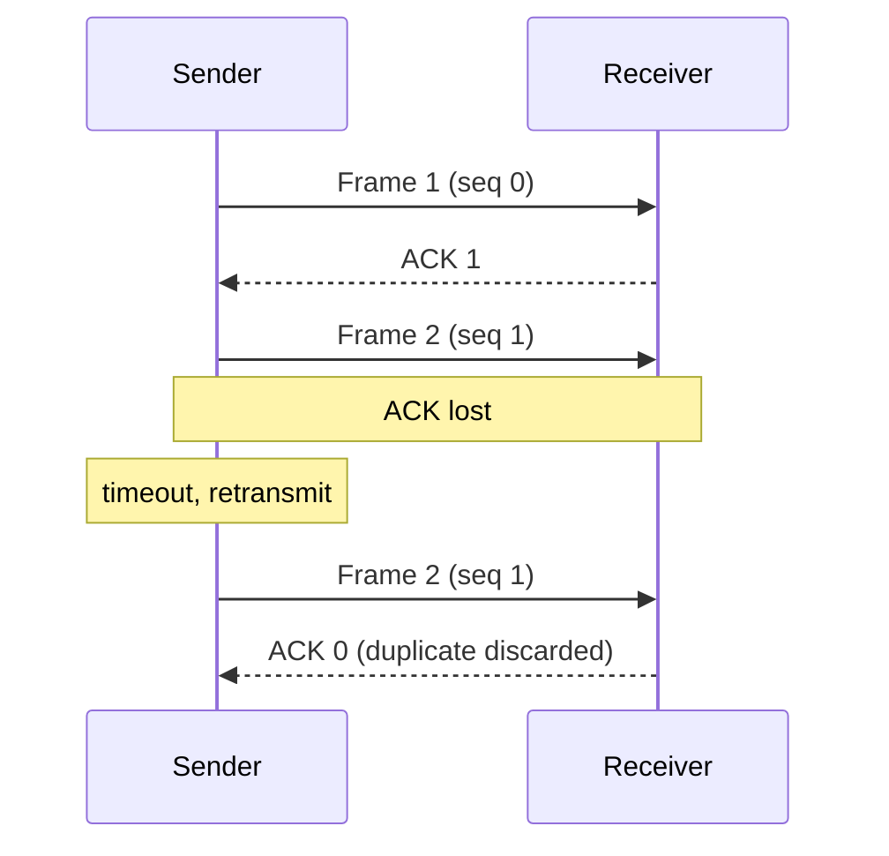

# Data Communication Demos: interactive bit stuffing and stop-and-wait ARQ

[](https://creativecommons.org/licenses/by-nc-sa/4.0/)
[](https://janeferdinant.github.io/bit/)

## Overview

Two small browser demos for teaching the data link layer: **bit stuffing and destuffing** (HDLC-style framing) and the **stop-and-wait ARQ protocol**. Students type their own input, see a step-by-step trace, and see what happens on bad input or a lossy channel. Written for a computer networks / data communication course.

## Demo

Live: <https://janeferdinant.github.io/bit/>

- Bit stuffing and destuffing: <https://janeferdinant.github.io/bit/bit_stuff.html>
- Stop-and-wait protocol: <https://janeferdinant.github.io/bit/stop_and_wait.html>

| Bit stuffing and destuffing | Stop-and-wait |
|---|---|
|  |  |

## Problem statement

- **Framing.** A bit-oriented link marks frame boundaries with the flag `01111110`. If the data contained that pattern, the receiver would end the frame early.
- **Reliability.** Over a channel that can lose frames or acknowledgements, the sender needs a rule for when to retransmit, and the receiver needs a way to ignore duplicates.

## Approach

**Bit stuffing** (`lib/bitstuff.mjs`). The sender inserts a `0` after every run of five consecutive `1`s, so six `1`s in a row can never occur in the data. The receiver removes the `0` that follows five `1`s. Example: `01111110` becomes `011111010` and destuffs back to `01111110`. The receiver rejects a stream that has six `1`s in a row, or that ends right after five `1`s.

**Stop-and-wait ARQ** (`lib/stopwait.mjs`). The sender sends one frame and starts a timer. If the ACK arrives within one round trip (1 s), it sends the next frame. If the frame or the ACK is lost, the timer expires and the same frame is retransmitted. Frames carry a 1-bit sequence number, so the receiver discards a duplicate when only the ACK was lost. The sender gives up on a frame after 8 attempts. The page runs the simulation in real time; the loss probability is a user input (0 to 80 percent, default 20).



## Data

None. All input is typed by the user and processed in the browser. Nothing is stored or sent anywhere.

## Results

No performance metrics: these are teaching demos. Verification of the demos themselves (run log: [`docs/runs/2026-10-13-bit-tests.md`](docs/runs/2026-10-13-bit-tests.md)):

| Check | Value | Status | How measured | Date |
|---|---|---|---|---|
| Unit tests (`npm test`) | 23 passed, 0 failed | Verified (re-run 2026-10-13) | `node --test` | 2026-10-13 |
| Browser tests at 390 px and 1280 px | 6 passed, 0 failed, no console errors, no horizontal overflow | Verified (re-run 2026-10-13) | Playwright 1.59.1, Chromium | 2026-10-13 |

## Tech stack

- Plain JavaScript modules for the logic (no dependencies); React 18.2.0 (production UMD build from jsDelivr, with Subresource Integrity) for the pages.
- JSX is precompiled with esbuild 0.28.2 into `js/`; styles are compiled with Tailwind CSS 3.4.19 into `css/site.css`. Both compiled outputs are committed, so the site needs no build step on GitHub Pages and no in-browser Babel.
- Tests: `node --test`, Playwright 1.59.1.
- Python 3 reference scripts (`bit_stuff_destuff.py`, `stop_and_wait.py`): command-line versions of the same ideas. The web pages do not use them.

## Getting started

Prerequisites: Node.js 20 or newer (tested on 22.20.0) and Python 3 for the optional scripts.

To use the demos, open the live site above. To run them locally:

```bash
git clone https://github.com/Janeferdinant/bit.git
cd bit
node scripts/serve.mjs
```

Expected output: `Serving the repo at http://localhost:4173/`. Open that address in a browser. React is loaded from the CDN, so you need an internet connection.

To run the tests and rebuild:

```bash
npm install
npm test
npx playwright install chromium
npm run test:e2e
npm run build
```

Expected: `npm test` ends with `# pass 23` and `# fail 0`; `npm run test:e2e` reports `6 passed`. `npm run build` regenerates `js/*.js` and `css/site.css`.

The Python scripts:

```bash
python bit_stuff_destuff.py
python stop_and_wait.py
```

The first prints the original, stuffed and destuffed bits for `01111110`. The second simulates five frames with a random 20 percent loss, so its output varies from run to run, and it takes several seconds because it really sleeps.

## Project structure

```
index.html            landing page
bit_stuff.html        bit stuffing and destuffing demo
stop_and_wait.html    stop-and-wait demo
lib/                  logic modules (bitstuff.mjs, stopwait.mjs), shared by pages and tests
src/                  React sources (JSX) and the Tailwind input
js/, css/             compiled output, committed for GitHub Pages
test/                 node --test suites
e2e/                  Playwright browser tests
scripts/serve.mjs     small static server for local use
bit_stuff_destuff.py, stop_and_wait.py   command-line reference versions
docs/                 screenshots and run logs
.github/workflows/    GitHub Pages workflow (GitHub's Jekyll starter; it publishes the repo files as-is)
```

`index.md` and `_layouts/default.html` are unused leftovers from an earlier Jekyll attempt; the site is served from `index.html`. There is no `_pages/` folder.

## Real-world applications

- Bit stuffing is used in HDLC and similar link protocols. USB uses a related idea at the physical layer (a `0` is inserted after six `1`s).
- Stop-and-wait is the simplest ARQ scheme and the baseline for sliding-window protocols.

## Limitations

- Teaching simulations: the channel is a random loss model with a fixed 1 s round trip, not a measurement of any real network.
- Stop-and-wait uses the channel poorly, because only one frame is in flight at a time. The demo does not show throughput or sliding-window variants.
- Frame labels are numbers only, and at most 20 frames are allowed.
- React is loaded from a CDN, so the pages need an internet connection.

## Future scope

- Go-Back-N and Selective Repeat demos.
- Let the user choose which frame or ACK to drop, instead of a random loss probability.
- Vendor React so the pages work offline.

## Credits & citation

Written by Jane Rose Ferdinant for teaching. React (MIT) is loaded from a CDN; the compiled stylesheet is generated by Tailwind CSS (MIT). See THIRD_PARTY_NOTICES.md.

## License

[CC BY-NC-SA 4.0](LICENSE). Original work © Jane Rose Ferdinant, licensed CC BY-NC-SA 4.0. Third-party components retain their own licenses; see THIRD_PARTY_NOTICES.md.

## Author

Jane Rose Ferdinant: [portfolio](https://janeferdinant.vercel.app) · [LinkedIn](https://www.linkedin.com/in/janerosenf/)
